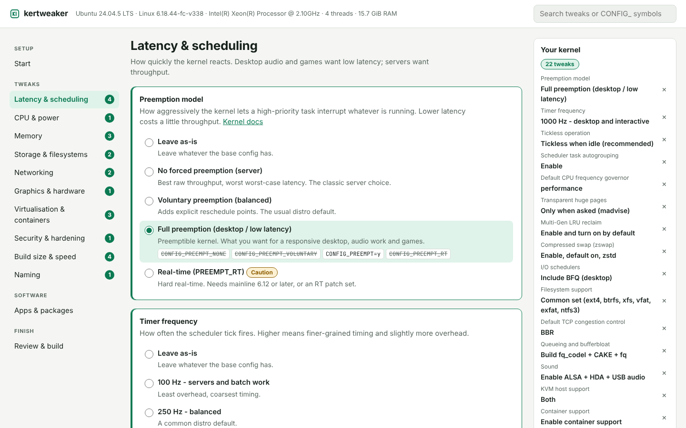
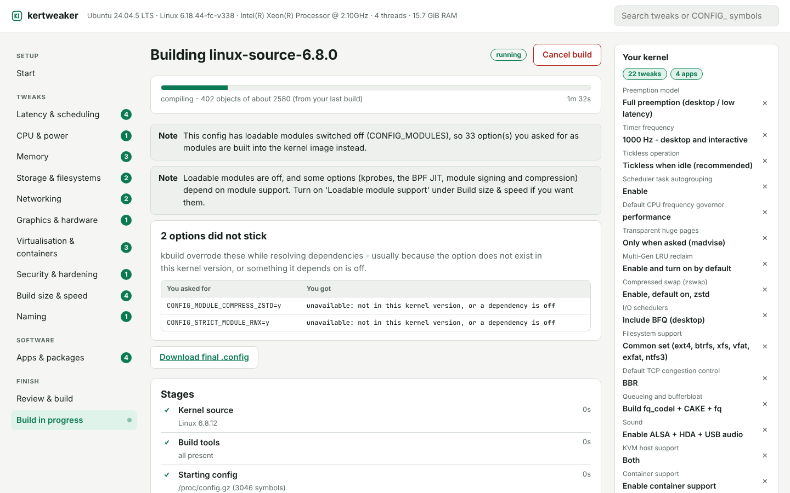
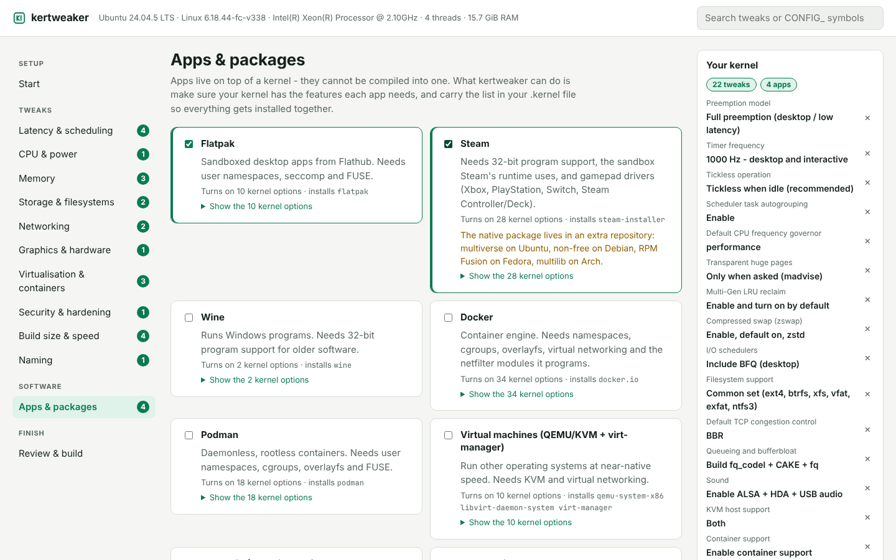
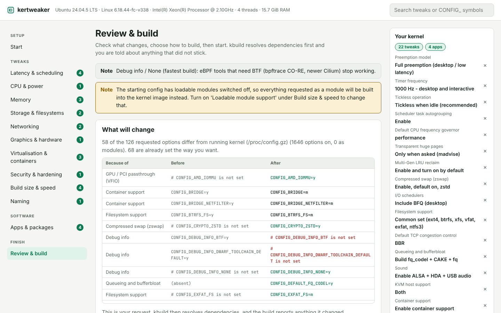

# kertweaker

Tweak a Linux kernel from a GUI, then build it for the machine you are sitting at.

You pick things in plain terms - "full preemption", "BBR networking", "ready for
Steam" - and kertweaker shows exactly which `CONFIG_` options that changes,
builds the kernel, and tells you about anything kbuild refused to apply.



- **One small binary, no dependencies.** Pure Rust standard library. The GUI is
  served from the binary to your browser on `127.0.0.1`.
- **Honest about what happened.** After `make olddefconfig`, every option you
  asked for is checked against the final config. Anything that did not stick is
  listed, instead of being discovered after a two-hour build.
- **`.kernel` files.** Save a whole kernel - tweaks, extra options, software,
  build settings - to one file. Open it later, on another machine, or share it.
- **Never installs behind your back.** It builds, then hands you the exact
  commands to install. Installing only happens if you ask *and* run it as root.

## Quick start

```bash
cargo build --release
```

```bash
./target/release/kertweaker
```

It prints a link such as `http://127.0.0.1:7878/?token=...`. Open it (it opens
by itself when there is a desktop session), then:

1. **Start** - check your machine is ready, pick a profile or open a `.kernel`
   file, choose the kernel source and the config to start from.
2. **Tweaks** - adjust anything. Each option shows the config lines it sets.
3. **Apps & packages** - pick the software this kernel should be ready for.
4. **Review & build** - see the before/after diff, save a `.kernel` file, build.



Check a machine before you start:

```bash
./target/release/kertweaker doctor
```

It lists every build tool and prints the one command that installs what is
missing on Debian/Ubuntu, Fedora/RHEL or Arch.

## What you can tweak

42 tweaks in ten groups, plus an "extra options" box for raw config lines:

| Group | Examples |
| --- | --- |
| Latency & scheduling | preemption model, timer frequency, tickless, autogroup |
| CPU & power | default frequency governor, CPU family, suspend/hibernate |
| Memory | transparent huge pages, MGLRU, zswap, zram, KSM |
| Storage & filesystems | I/O schedulers, filesystem sets, NFS/SMB |
| Networking | BBR, fq_codel/CAKE, WireGuard |
| Graphics & hardware | which GPU drivers to build, sound |
| Virtualisation & containers | KVM, virtio guest, container support, VFIO |
| Security & hardening | hardening levels, LSM, module signing, mitigations |
| Build size & speed | debug info, localmodconfig, LTO, compression, modules |
| Naming | version suffix |

Seven built-in profiles: `desktop`, `gaming`, `laptop`, `server`, `vm_guest`,
`fast_build` and `hardened`. The GUI suggests one for your machine.

Options are marked **Caution** or **Risky** where they can cost you a bootable
or secure machine, and risky selections need an explicit confirmation.

## Apps & packages

Applications are not part of a kernel and cannot be compiled into one. What a
kernel *can* do is carry the features an application depends on. So picking an
app does two things:

1. **Its kernel requirements are added to your config** and verified like any
   tweak. Steam gets 32-bit program support and gamepad drivers; Flatpak gets
   user namespaces, seccomp and FUSE; Docker gets its cgroup and netfilter
   options; Waydroid gets the Android binder driver.
2. **It goes on your install list.** After the build, kertweaker prints the
   command that installs everything with your package manager. It does not run
   it for you.



Built in: Flatpak, Steam, Wine, Docker, Podman, QEMU/KVM + virt-manager,
Waydroid, OBS Studio, WireGuard tools, GIMP, VLC and Discord. Apps that need
nothing special from the kernel (GIMP, VLC, Discord) only join the install list.

Any other package name can be added too. kertweaker asks your package manager
whether each name exists: an app whose native package is not in your enabled
repositories falls back to its Flatpak, and a name nothing recognises is
reported and left out, so one typo cannot fail the whole install command.

## `.kernel` files

A `.kernel` file is a saved kernel: which version, what config to start from,
the tweaks, extra options, software and build settings. It is readable JSON, so
it diffs well and can live in version control.

```json
{
  "format": "kertweaker.kernel",
  "version": 1,
  "name": "gaming-rig",
  "kernel": { "version": "6.12.1" },
  "tweaks": { "preempt": "full", "hz": "1000", "tcp_cc": "bbr" },
  "extra_options": ["CONFIG_USB_SERIAL=m"],
  "software": ["steam", "flatpak"],
  "packages": ["htop"],
  "build": { "output": "deb", "clang": false },
  "base": { "mode": "running" }
}
```

In the GUI: **Open a .kernel file** on the Start page, **Save .kernel file** on
the Review page. From a terminal:

```bash
kertweaker gaming-rig.kernel
```

```bash
kertweaker show gaming-rig.kernel
```

```bash
kertweaker build --file gaming-rig.kernel
```

```bash
kertweaker export -o gaming-rig.kernel --profile gaming --app steam --kernel 6.12.1
```

By default a recipe starts from the config of whatever kernel the building
machine runs, which keeps that machine's drivers. Tick **Include the full
starting config** (or pass `--embed-config`) to store the complete `.config`
inside the file, so it rebuilds the same kernel anywhere.

Opening a file only fills in the form. Nothing is built or installed until you
review it and press Build. Files are treated as untrusted: unknown tweaks are
dropped with a warning, versions and package names are validated, and a file
cannot name a path on your disk to read.

## How it decides what your config ends up as

kertweaker does not reimplement Kconfig's dependency solver. It:

1. Starts from a base config - by default the one your running kernel uses, so
   every driver your hardware needs is already on.
2. Optionally trims to the modules you have loaded (`make localmodconfig`).
3. Applies your tweaks, then what your software needs, then your extra options,
   the way the kernel's own `merge_config.sh` does. When a later layer
   overrides an earlier one, the Review page says so.
4. Runs `make olddefconfig` so kbuild resolves dependencies.
5. Compares the result with what you asked for and reports the differences:
   options that did not take effect, options built in rather than as modules,
   and why when it can tell (for example, module support being switched off).



## Command line

Everything the GUI does is scriptable:

```bash
kertweaker profiles
```

```bash
kertweaker tweaks --group latency
```

```bash
kertweaker apps
```

```bash
kertweaker fragment --profile desktop --set hz=300 --app steam
```

```bash
kertweaker build --kernel 6.12.1 --profile desktop --app flatpak --output deb
```

```bash
kertweaker build --tree ~/src/linux --base defconfig --set preempt=full --config-only
```

`kertweaker --help` lists every flag. `--config-only` writes and verifies the
`.config` without compiling, which is a quick way to try a selection.

## Requirements

- Linux, and Rust 1.74 or newer to build kertweaker itself.
- To build kernels: `gcc`, `make`, `flex`, `bison`, `bc`, `openssl`, `tar`,
  `xz`, `gzip`, `kmod`, plus the libelf and ncurses headers. `kertweaker
  doctor` prints the exact install command for your distribution.
- `curl` or `wget` to download kernels from kernel.org. Not needed if you point
  it at a source tree you already have.
- For `.deb` output: `dpkg-dev`, `debhelper` and `rsync`. For `.rpm` output:
  `rpm-build`. kertweaker checks before it starts and tells you what is missing.
- Optional, depending on what you select: `pahole` (BTF), `clang` + `lld`
  (LTO), `zstd`/`lz4` (compression), GCC plugin headers (stack-leak clearing
  and struct randomisation on kernels before 6.17).

Disk and time: a full build uses 2-30 GiB depending mostly on debug info. The
*Fastest possible build* profile is the quickest way to a first kernel.

## Installing what you built

kertweaker shows these for you with a copy button; they are listed here so you
know what to expect.

Debian packages (recommended on Debian/Ubuntu - it removes cleanly too):

```bash
sudo dpkg -i linux-image-*.deb linux-headers-*.deb
```

Plain image, run from the source tree:

```bash
sudo make modules_install
```

```bash
sudo make install
```

Keep your current kernel installed. If the new one misbehaves, pick the old one
from the boot menu.

**Secure Boot:** a kernel you build yourself is unsigned. With Secure Boot on,
the firmware refuses it unless you sign it with an enrolled key (MOK) or turn
Secure Boot off. `kertweaker doctor` and the GUI both warn when it is on.

## Security

The GUI can start builds, so access to it is restricted:

- It listens on `127.0.0.1` only.
- Every run generates a random access token. The printed link carries it once;
  it is exchanged for an `HttpOnly`, `SameSite=Strict` cookie and never
  embedded in a page.
- The `Host` header is checked, which defeats DNS rebinding, and cross-origin
  POSTs are refused.
- Kernel versions, package names and saved names are validated before they
  reach a command line or a file name. Commands are run without a shell.
- `.kernel` files are parsed as untrusted input, and package install commands
  are only ever shown, never run.

Run it as your normal user. Only the final install steps need root, and you run
those yourself.

Stopping kertweaker stops the build: the whole `make` process tree is torn down
whether you press Cancel, hit Ctrl+C, or the program is killed.

## Where things are kept

`~/.local/share/kertweaker` by default (`--workdir` or `KERTWEAKER_HOME` to
change it): downloaded tarballs, extracted sources, the config and fragment
from every build, full build logs, and the kernels you chose to keep.

## Development

```bash
cargo test
```

The suite includes an end-to-end run of the whole build pipeline against a stub
kbuild, so it needs no kernel tree and finishes in a few seconds.

The tweak catalog lives in `src/catalog.rs` and the software catalog in
`src/software.rs`. Tests check that every profile resolves, that no two tweaks
or apps fight over a symbol, and that renamed symbols are declared as aliases.
Before adding an option, confirm it against a real tree:

```bash
kertweaker build --tree /path/to/linux --base defconfig --set TWEAK=OPTION --config-only
```

```bash
kertweaker build --tree /path/to/linux --base defconfig --app APP --config-only
```

If verification reports the option did not stick, it is missing a dependency.

## License

MIT
